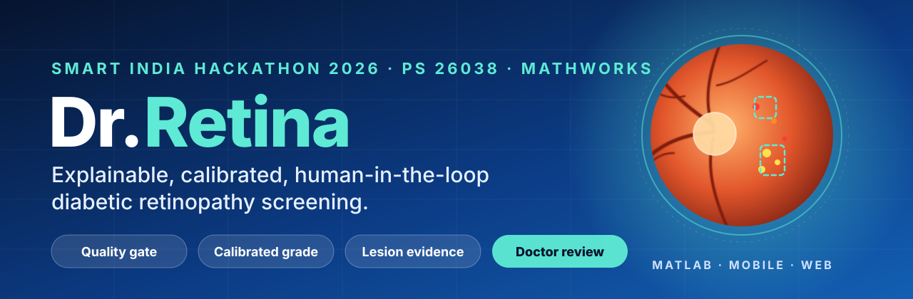
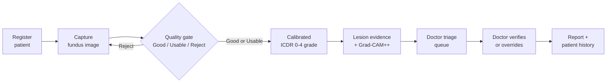
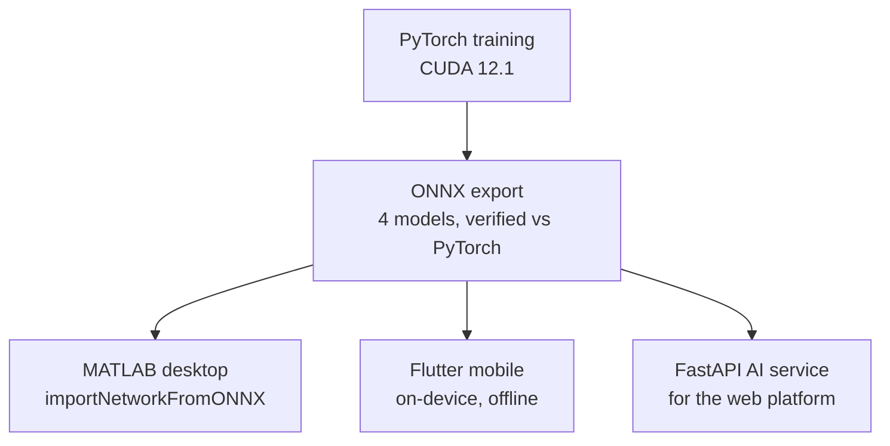
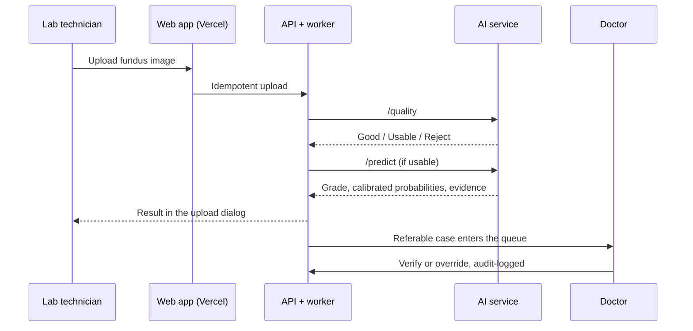

<p align="center">
  
</p>

<p align="center">
  <a href="https://dr-retina-web.vercel.app"><b>Live demo</b></a> &nbsp;·&nbsp;
  <a href="#the-30-second-tour">30-second tour</a> &nbsp;·&nbsp;
  <a href="#the-ai-pipeline">AI pipeline</a> &nbsp;·&nbsp;
  <a href="#one-brain-three-surfaces">Three surfaces</a> &nbsp;·&nbsp;
  <a href="#results">Results</a> &nbsp;·&nbsp;
  <a href="#running-it">Run it</a>
</p>

<p align="center">
  
  
  
  
  
  
  
</p>

# Dr.Retina

**Smart India Hackathon 2026 · Problem Statement 26038 · MathWorks · MedTech**

> *From a retinal photograph to an actionable clinical decision.*

Diabetic retinopathy (DR) blinds silently and is treatable if caught early. India has more than
**77 million adults with diabetes** and roughly **one ophthalmologist per 100,000 rural people**.
Clinics often have a camera and a trained operator, but nobody to read the images.

Dr.Retina treats screening as a **complete clinical pathway**, not a single model:



The same four trained networks run, unchanged, on **three independent surfaces**: a **MATLAB desktop
app**, an **offline Flutter mobile app**, and a **multi-tenant web platform**, with a **Simulink SimEvents**
model that sizes a district programme for 100,000+ patients a year.

---

## The 30-second tour

1. Open **https://dr-retina-web.vercel.app** and go to **Sign In**.
2. Pick a role card (Doctor, Lab Technician or Administrator) and click the blue
   **"Demo login as … (for judges)"** link. No password, no email. It opens a sample organization with no real patient data.
3. As **Lab Technician**: register a patient and upload a fundus image. You get the **image-quality verdict and the
   calibrated grade** in the upload dialog within seconds.
4. Switch to **Doctor**: the referable case is in the priority queue, ready to verify or override.
5. Switch to **Administrator**: users, organization activity and the audit trail.

> The production sign-in path is invite-only. Demo access is a separate, switchable convenience for reviewers.

---

## Why this is different

| Typical screening demo | Dr.Retina |
|---|---|
| Image → model → label | Register → capture → validate → grade → explain → review → report → monitor |
| Accepts any image | **Quality gate** rejects unusable photos at the point of capture, with a retake prompt |
| Raw softmax confidence | **Temperature-calibrated** confidence, checked on datasets the model never saw |
| Heatmap only | **Pixel-level lesion segmentation** plus real Grad-CAM++ attention |
| One demo surface | **MATLAB, offline mobile and web** from the same exported models |
| Single user | **Multi-tenant roles**, invite-only clinical accounts, database-enforced isolation |
| "It runs" | A **capacity model** showing one ophthalmologist sustains 100,000+ patients a year |
| Self-reported accuracy | **Locked external test sets** and pre-registered model selection |

---

## The AI pipeline

Four specialised networks, each with one clear job:

| Stage | Model | Notes |
|---|---|---|
| **Image-quality gate** | EfficientNet-B0, 3 classes (Good / Usable / Reject) | Trained on EyeQ + DRIMDB. A rejected image never reaches the grader. |
| **DR grading** | ResNet-50, 5 ICDR classes (0-4) | Trained on EyePACS + APTOS 2019 + DDR. Compact CNN by design, so it runs on modest clinic hardware. |
| **Calibration** | Temperature scaling (T ≈ 5.38) | Makes the reported confidence reflect real reliability. |
| **Optic disc** | U-Net with whole-image context | Dice **0.842**. |
| **Lesions (MA / HE / EX / SE)** | U-Net, pretrained ResNet-34 encoder, **Focal Tversky Loss** | Trained on a merge of IDRiD + DDR + e-ophtha (~1,300 images). Built for tiny, heavily imbalanced targets. |
| **Explainability** | **Grad-CAM++** from real gradients | Always labelled *model attention (coarse)*, never presented as a detected lesion location. The segmentation head provides the per-lesion evidence. |

### Trustworthy confidence

A probability is only useful if it is true. Raw networks are overconfident, so we fitted a temperature
on validation data. Calibration error fell by **83%**, and the improvement held on two datasets locked away
from all training and tuning:

| Dataset | Expected calibration error before | after |
|---|---|---|
| Validation | 0.142 | **0.025** |
| IDRiD (external) | 0.356 | **0.105** |
| Messidor-2 (external) | 0.245 | **0.042** |

---

## One brain, three surfaces



Every export is verified numerically against PyTorch before any surface uses it (max difference below
5×10⁻⁶ for grading and quality, below 3×10⁻⁵ for the lesion model). On the same image, calibrated
confidence is **0.725 in MATLAB and 0.720 in Python**, with an identical lesion pattern. A result on one
surface can be reproduced on the others.

### 1. MATLAB desktop app (primary platform) · [`matlab/`](matlab)
Built with App Designer components and **Deep Learning Toolbox** (`importNetworkFromONNX`),
**Image Processing Toolbox**, **Simulink** and **SimEvents**. Upload a fundus image and the app shows the
quality badge, ICDR grade, calibrated confidence, referable flag, class probabilities and a colour-coded
lesion overlay (microaneurysms red, haemorrhages orange, hard exudates yellow, soft exudates cyan, optic disc green).
Fully local and offline.

### 2. Simulink capacity model · [`matlab/screening_capacity_model.m`](matlab/screening_capacity_model.m)
A SimEvents model of *capture → AI grading → ophthalmologist review*, parameterised from our own
measurements: a **27.4% referable rate** from our validation split, real image sizes for transmission time,
and the problem statement's **30-second review target**.

| Stage | Utilisation |
|---|---|
| Capture | ~0.18% |
| AI grading | ~0.14% |
| Ophthalmologist review | **~11.4%** (about 0.9 h of an 8 h day) |

**One ophthalmologist can sustain a 100,000-patient-per-year programme** at this referable rate.

### 3. Flutter mobile app · [`mobile/`](mobile)
The full pipeline runs **on the phone with no server and no internet**, through `flutter_onnxruntime`.
Camera capture screen with an **alignment guide for clip-on fundus attachments**, plus a gallery path.
About **7-11 seconds** per screening on an Android emulator, with results matching the Python and MATLAB
references to within rounding.

### 4. Web clinical platform · [`website/`](website)
Next.js 16 · FastAPI · PostgreSQL on Supabase with row-level security.

| Role | How they join | What they do |
|---|---|---|
| **Organization Admin** | The only self-registration path (creates the organization) | Invite staff, manage users, oversee activity |
| **Doctor** | Invite link only | Prioritised queue, evidence review, confirm or override the AI grade, finalise reports |
| **Lab Technician** | Invite link only | Register patients, upload images, see quality and grade immediately |



---

## Security and trust engineering

| Concern | Mechanism |
|---|---|
| Tenant isolation | PostgreSQL **row-level security**: one organization cannot read another's patients or screenings |
| Who can join | Invite-only clinical roles, enforced in application code **and** by a database policy |
| Least privilege | Separate `retina_api` and `retina_worker` database roles; neither is a superuser or bypasses RLS |
| Session trust | Server verifies identity remotely (`getUser()`); the backend independently verifies bearer tokens |
| Email-link safety | Confirmation links open an explicit click-to-confirm page, so email scanners cannot burn one-time tokens |
| Credential hygiene | Every form submits with `method="post"`; credentials can never leak into URLs or logs |
| CSRF | The API proxy checks the request `Origin` |
| Duplicate protection | Idempotency keys on uploads and AI calls |
| Input trust | Strict schema validation of every AI response (probabilities must sum to 1; confidence must match the top class) |
| Accountability | **Audit log** of significant actions |

---

## Scientific rigour

1. **IDRiD and Messidor-2 are locked external test sets.** They are never trained or tuned on, and
   `src/data/make_splits.py` hard-fails if any of their files leaks into training or validation.
2. **Same-dataset accuracy is not a success metric.** Acceptance gates are measured externally
   (`src/eval/external_eval.py`).
3. **Model selection follows rules fixed in advance**, even when the simpler model wins. An augmented variant
   scored 0.811 internal QWK against the baseline's 0.816, so the baseline stayed in production.
4. **Compact CNNs for production** (ResNet-50, EfficientNet-B0), chosen for deployability.
5. **Grad-CAM is labelled as model attention.** The lesion segmentation head carries the per-lesion evidence.
6. **Confidence is reported per class**, and lower-confidence signals are marked as such in every interface.

---

## Results

| Component | Result |
|---|---|
| DR grading, internal validation | QWK **0.816** |
| Calibration error (validation) | 0.142 → **0.025** (−83%) |
| Calibration error (IDRiD, unseen) | 0.356 → **0.105** |
| Calibration error (Messidor-2, unseen) | 0.245 → **0.042** |
| Optic-disc segmentation | Dice **0.842** |
| Hard exudates / haemorrhages / soft exudates | Dice **0.305 / 0.254 / 0.244** |
| ONNX fidelity vs PyTorch | max difference **< 5×10⁻⁶** (grading, quality) |
| MATLAB vs Python calibrated confidence | **0.725 vs 0.720** on the same image |
| Mobile on-device screening | **≈ 7-11 s** per image (Android emulator) |
| Capacity model | **1 ophthalmologist** sustains **100,000+ patients/year** (~11% utilisation) |
| Web platform tests | **36** automated tests; typecheck, lint and production build clean |

**Datasets** · Grading: EyePACS, APTOS 2019, DDR. Locked external test: IDRiD, Messidor-2.
Lesion segmentation: IDRiD + DDR + e-ophtha. Quality gate: EyeQ + DRIMDB. Provenance in
[`data/manifest.csv`](data/manifest.csv) and [`docs/DATASETS.md`](docs/DATASETS.md).

---

## Scope and roadmap

Dr.Retina is a **screening and decision-support prototype, not a validated clinical device**, and every
interface says so.

- **Microaneurysm segmentation** (Dice 0.029) is a proof of concept on ~1,300 images. Published results on far
  larger expert-labelled sets reach ~0.56. It is marked low-confidence everywhere.
- **Referable-DR operating point:** thresholds were analysed against both locked external sets, and the
  sensitivity/specificity trade-off across domains is documented in [`docs/SIH_SUBMISSION_PLAN.md`](docs/SIH_SUBMISSION_PLAN.md).
- **Next:** more lesion data and a dedicated microaneurysm detector; CLAHE / illumination enhancement for
  borderline images; vessel segmentation and neovascularisation detection; automated follow-up scheduling;
  multi-disease screening; **prospective clinical validation and the regulatory pathway**.
- The Simulink model runs its analytical queueing fallback on our trial MATLAB install (the discrete-event
  engine needs a compiler toolchain it did not recognise). Parameters are identical either way.

---

## Repo layout

```
src/
  data/       download.py, harmonize.py, make_splits.py, make_fiqa_splits.py, dataset.py
  models/     fiqa.py, dr_backbone.py, lesion_unet.py
  train/      engine.py, train_fiqa.py, train_baseline.py, train_lesion_segmentation*.py
  eval/       metrics.py, external_eval.py, calibrate_model.py, tune_referable_threshold.py
  explain/    gradcam.py, report.py   combined quality + grade + Grad-CAM++ + lesion report
  serve/      export_onnx.py, ai_service.py   ONNX export, FastAPI AI service
matlab/       App Designer clinical app, native ONNX import, SimEvents capacity model
mobile/       Flutter app: fully offline, on-device inference
website/      Next.js + FastAPI web platform (3 role-based portals)
deploy/       Docker Compose + Caddy for a one-VM backend deployment
data/         raw/ (gitignored downloads), processed/, splits/, manifest.csv
docs/         DATASETS.md, IMPLEMENTATION_PLAN.md, PROBLEM_STATEMENT.md, SIH_SUBMISSION_PLAN.md
configs/      training and calibration configs
notebooks/    exploratory only; nothing here is a dependency of src/
```

Model checkpoints and ONNX exports (`*.pt`, `*.onnx`) are gitignored. They are regenerable with the commands below.

---

## Running it

### Python pipeline (training / evaluation)
PyTorch has no CUDA wheels for Python 3.14 yet, so use a Python 3.12 venv. Only the NVIDIA **driver** is
required; the CUDA runtime ships inside the PyTorch wheel.

```bash
py -3.12 -m venv .venv
./.venv/Scripts/python.exe -m pip install torch torchvision --index-url https://download.pytorch.org/whl/cu121
./.venv/Scripts/python.exe -m pip install -r requirements.txt
./.venv/Scripts/python.exe -c "import torch; print(torch.cuda.is_available())"   # must print True
```

```bash
python -m src.data.download --all
python -m src.data.harmonize
python -m src.data.make_splits              # external sets required + leakage-checked
python -m src.train.train_fiqa --config configs/fiqa_efficientnet_b0.yaml
python -m src.train.train_baseline --config configs/baseline_resnet50.yaml
python -m src.train.train_lesion_segmentation_v2 --config configs/lesion_segmentation_v2.yaml
python -m src.serve.export_onnx \
    --dr-checkpoint reports/checkpoints/p0_baseline_resnet50/best.pt \
    --fiqa-checkpoint reports/checkpoints/p0_fiqa_effnet_b0/best.pt \
    --lesion-checkpoint reports/checkpoints/p2_lesion_segmentation/best.pt \
    --lesion-v2-checkpoint reports/checkpoints/p2d_lesion_segmentation_v2/best.pt
    # writes reports/onnx/*.onnx
```

### MATLAB app
Requires **Deep Learning Toolbox** with the **ONNX Model Format converter** add-on, **Image Processing Toolbox**,
**Simulink** and **SimEvents** (capacity model only).

```matlab
app = DrRetinaScreeningApp;     % full screening UI
```

### Mobile app
```bash
cd mobile
flutter pub get
flutter run
```
Copy `reports/onnx/*.onnx` and `reports/checkpoints/p0_baseline_resnet50/calibration.json` into
`mobile/assets/` first (see `mobile/pubspec.yaml`).

### Web platform and backend
- Local setup: [`website/Dr.Retina---AI-based-healthcare-webapp-main/README.md`](website/Dr.Retina---AI-based-healthcare-webapp-main/README.md),
  `AUTH_SETUP.md` and `AI_INTEGRATION.md`.
- AI adapter service:
  ```bash
  AI_SERVICE_KEY=<key> AI_MODEL_VERSION=<version> \
    uvicorn src.serve.ai_service:app --host 0.0.0.0 --port 8100
  ```
- **One-VM production deployment** (API + worker + AI service + automatic HTTPS): see [`deploy/README.md`](deploy/README.md).

---

## Ground rules (do not violate)

1. **IDRiD and Messidor-2 are locked external test sets.** Never train or tune on them.
2. Internal accuracy or QWK is not a success metric on its own. Every gate is measured externally.
3. Compact CNN (ResNet-50 / EfficientNet-B0) over transformer or foundation models for production.
4. Grad-CAM is labelled "model attention (coarse)" in any UI or report, never "detected lesion location".
5. Lesion-segmentation confidence is reported honestly, per class. Never round a weak result up to sound finished.

Dataset governance: [`docs/DATASETS.md`](docs/DATASETS.md) · Delivery plan and full build history:
[`docs/SIH_SUBMISSION_PLAN.md`](docs/SIH_SUBMISSION_PLAN.md) · License: [MIT](LICENSE)

<p align="center"><b>From pixels to prevention · From detection to decision · From screening to continuous care</b></p>
